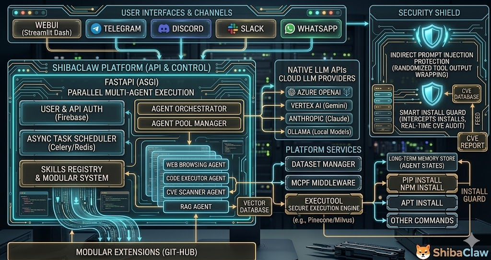

<p align="center">
  
</p>

<h1 align="center">ShibaClaw</h1>

<p align="center"><b>A self-hosted personal AI agent with a built-in WebUI. Use local or cloud models, with memory, tools and automations in one place.</b></p>

<p align="center">
  <a href="https://pypi.org/project/shibaclaw/"></a>
  <a href="https://pepy.tech/projects/shibaclaw"></a>
  <a href="https://hub.docker.com/r/rikyz90/shibaclaw"></a>
  
  <a href="https://github.com/RikyZ90/ShibaClaw/blob/main/LICENSE"></a>
  <a href="https://github.com/RikyZ90/ShibaClaw/actions/workflows/ci.yml"></a>
  <a href="https://deepwiki.com/RikyZ90/ShibaClaw"></a>
</p>

## Demo

<p align="center">
  
  
</p>

## Why ShibaClaw?

For people who want a personal AI assistant they can install and operate on their own machine or server, with a UI and configurable tools ready to use.

- **One place to work** — built-in WebUI, a Windows desktop launcher, and a mobile layout for access over your LAN.
- **Your choice of model** — local LLMs through Ollama or an OpenAI-compatible server; cloud providers and documented OAuth integrations.
- **Persistent context** — editable memory, reusable skills, and an optional document knowledge base.
- **Tools and MCP** — file, shell and web tools, plus external tools through the Model Context Protocol.
- **Multi-agent tasks and automation** — isolated or forked sub-agents, scheduled tasks, and optional [project verification](docs/PROJECT_VERIFICATION.md).
- **Security controls in the core** — an encrypted credential vault, workspace restrictions, SSRF filtering and prompt-injection defenses. See [their scope and limits](#security).

Compare requirements in [ShibaClaw vs OpenClaw, nanobot and Hermes Agent](docs/COMPARISON.md).

## Quick Start

**Requirements:** Docker, or Python 3.12+ for the pip route. The Windows auto-installer needs neither — it ships a pre-built desktop app.

### Auto-installer (recommended)

Choose the installer for your operating system, or use Docker or pip below.

> [!TIP]
> Bring your own model: start with [Ollama](docs/integrations/OLLAMA.md), an OpenAI-compatible endpoint, or a cloud provider such as [OpenRouter](docs/integrations/OPENROUTER.md). Model availability, pricing and limits depend on the provider.

**🪟 Windows (PowerShell):**
```powershell
irm https://github.com/RikyZ90/ShibaClaw/releases/latest/download/install.ps1 | iex
```

Or download and open **[ShibaClaw-Setup.exe](https://github.com/RikyZ90/ShibaClaw/releases/latest/download/ShibaClaw-Setup.exe)**. The PowerShell command downloads the same setup, verifies its SHA256 against the GitHub release asset digest, and starts it.

**🐧 Linux / 🍎 macOS:**
```bash
curl -fsSL https://github.com/RikyZ90/ShibaClaw/releases/latest/download/install.sh | bash
```

> [!NOTE]
> Windows setup installs per user and preserves existing data. Linux/macOS use pip in an isolated virtual environment. See [Windows installation, updates and portable ZIP options](docs/WINDOWS_INSTALLATION.md).

### Docker

```bash
curl -fsSL https://raw.githubusercontent.com/RikyZ90/ShibaClaw/main/docker-compose.yml -o docker-compose.yml
docker compose up -d     # pulls from Docker Hub
```

Open `http://localhost:3000`, create your admin account on first launch (or sign in to an existing account), and follow the onboarding wizard. To reach it from your phone, configure authenticated access over your LAN, for example through an HTTPS reverse proxy.

### pip

```bash
pip install shibaclaw
shibaclaw web --with-gateway   # starts WebUI + agent engine on :3000
```

Open `http://localhost:3000`, create your admin account on first launch and follow the onboarding wizard. `shibaclaw onboard` configures the agent and workspace from the CLI; WebUI account creation still happens in the browser.

If ShibaClaw is useful to you, consider [starring the repository](https://github.com/RikyZ90/ShibaClaw) to help others discover it.

## Explore

[Demo](#demo) · [Why ShibaClaw?](#why-shibaclaw) · [Installation](#quick-start) · [Features](#features) · [Integrations](docs/integrations/README.md) · [Documentation](docs/README.md)

[Providers](#supported-providers) · [MCP](#mcp--integrations) · [Memory](#memory-system) · [Security](#security) · [Comparison](docs/COMPARISON.md) · [Architecture](#architecture) · [Contributing](CONTRIBUTING.md) · [Releases](#whats-new)

🌐 [简体中文](README.zh-CN.md) · [Español](README.es.md) · [Português (BR)](README.pt-BR.md) · [日本語](README.ja.md) · [Deutsch](README.de.md) · [Français](README.fr.md) · [Italiano](README.it.md)

Translations retain their existing content; see the [synchronization checklist](docs/CONTRIBUTING_IDEAS.md#readme-translation-sync) for this README revision.

## Features

| Area | Included capabilities | Learn more |
|---|---|---|
| Agent runtime | Provider retries, durable tool journaling, context/resource guards, isolated or forked sub-agents | [Project verification](docs/PROJECT_VERIFICATION.md) |
| Interactive WebUI | In-turn questions (`ask_user`), progress cards, masked credentials, permission controls | [Demo](#demo) |
| Memory and knowledge | Editable long-term memory, session history, reusable skills, optional document retrieval | [Memory](#memory-system), [RAG](#knowledge-base-rag) |
| AI automation | One-shot, interval and cron schedules; heartbeat tasks | [Automations](#automation--scheduling) |
| Communication | WebUI and messaging integrations, including Discord, Telegram, Slack and Matrix | [Channels](#channels) |
| Extensions | MCP tools, channel and TTS plugins, opt-in self-evolution with validation gates | [MCP](#mcp--integrations), [Plugins](#plugin-system) |

---

## Security

Security controls are part of the agent runtime. Their effectiveness depends on configuration, installed audit tools and the tools you authorize.

| Layer | What it does |
|---|---|
| Credential storage | Fernet-encrypted vault; encryption key in the OS keyring when available, with a restricted key-file fallback |
| Install-time audit | Checks recognized package-install commands; blocks findings at the configured severity when the audit completes. Missing tools, errors or timeouts can allow installation with a warning |
| Prompt-injection defenses | Randomized tool-output boundaries and pre-scanning of untrusted content |
| Shell hardening | Deny patterns, escape normalization, internal URL detection |
| Network guard | SSRF filtering, redirect revalidation, DNS-rebinding-safe resolution |
| Workspace sandbox | File tools and file browser restricted to the configured workspace by default |
| Access control | Admin username/password login, session-token authentication, channel allowlists, optional rate limiting |

Prompt-injection defenses reduce exposure to untrusted tool output; they cannot guarantee safe model behavior. Protect the host account and vault key, review tool permissions, and use authentication and HTTPS when exposing the WebUI beyond localhost. Using a cloud model or remote MCP service sends relevant content to that service.

> [!TIP]
> Tool-output wrapping is also available as [Muzzle](https://github.com/RikyZ90/Muzzle). See the [security policy](SECURITY.md) for reporting and the [implementation](shibaclaw/security/) for current controls.

## Memory System

ShibaClaw keeps context at three levels:

1. **Working memory** (per session) — rolling context with automatic summarization and token-aware truncation
2. **Long-term memory** (cross-session) — editable `USER.md`, `memory/MEMORY.md` and `memory/HISTORY.md`, with fact extraction and ranked history search
3. **Procedural memory** (skills & automations) — learned workflows saved as reusable skills, plus cron-like schedules

The WebUI exposes memory editing, the dream diary and quarantined entries; sessions are stored as append-only JSONL. The optional [knowledge base](#knowledge-base-rag) adds FAISS document retrieval separately from these memory files.

## MCP & Integrations

ShibaClaw is an MCP agent: it connects to external tools using the Model Context Protocol and registers the tools returned by each configured server. Add servers in Settings; transport, authentication and tool behavior must be compatible with the server you choose.

Connected Apps integrates with [Klavis](https://klavis.ai) for hosted OAuth connections and MCP servers. Available apps and access depend on your Klavis account. Review each server's permissions and data handling before connecting it.

For model setup, use the dedicated [integration guides](docs/integrations/README.md): [OpenAI Codex](docs/integrations/OPENAI_CODEX.md), [Claude](docs/integrations/CLAUDE.md), [GitHub Copilot](docs/integrations/GITHUB_COPILOT.md), [OpenRouter](docs/integrations/OPENROUTER.md) and [Ollama](docs/integrations/OLLAMA.md).

## Supported Providers

ShibaClaw uses provider-specific adapters and OpenAI-compatible endpoints, without a LiteLLM proxy. It resolves the provider from the selected model or a provider-prefixed model ID. Configured provider catalogs appear in the WebUI; the [provider registry](shibaclaw/thinkers/registry.py) is the source of truth for supported routes.

**API key**

| Provider | Env variable |
|---|---|
| OpenAI | `OPENAI_API_KEY` |
| Anthropic | `ANTHROPIC_API_KEY` — see [current authentication limitation](docs/integrations/CLAUDE.md) |
| DeepSeek | `DEEPSEEK_API_KEY` |
| Google Gemini | `GEMINI_API_KEY`¹ |
| Groq | `GROQ_API_KEY` |
| Moonshot | `MOONSHOT_API_KEY` |
| MiniMax | `MINIMAX_API_KEY` |
| Zhipu AI | `ZAI_API_KEY` |
| DashScope | `DASHSCOPE_API_KEY` |

¹ Setting `GEMINI_API_KEY` is sufficient — the OpenAI-compatible endpoint is pre-configured.

**Gateway / proxy** — OpenRouter, AiHubMix, SiliconFlow, VolcEngine, BytePlus, auto-detected by key prefix or `api_base`.

**Local** — Ollama, LM Studio, llama.cpp, vLLM, or any OpenAI-compatible endpoint.

> [!NOTE]
> In Docker, `localhost` points inside the container. On Docker Desktop, use `host.docker.internal` to reach a host model server; native Linux needs a reachable host address or host-gateway mapping. See the [Ollama networking instructions](docs/integrations/OLLAMA.md#docker-or-another-host), including the required `/v1` API base.

**Account connections** — availability and permitted use depend on each provider's current terms and your account.

| Provider | Flow | Setup |
|----------|------|-------|
| OpenRouter | PKCE browser flow; returned API key saved in the credential vault | [Setup guide](docs/integrations/OPENROUTER.md) |
| GitHub Copilot | Device flow with token refresh | [CLI and WebUI setup](docs/integrations/GITHUB_COPILOT.md) |
| OpenAI Codex | PKCE browser flow | [CLI and WebUI setup](docs/integrations/OPENAI_CODEX.md) |
| Claude | Existing subscription OAuth compatibility path; provider restrictions apply | [Requirements and caveats](docs/integrations/CLAUDE.md) |
| Google Gemini CLI | PKCE browser flow, requires `SHIBACLAW_GEMINI_OAUTH_CLIENT_ID` and `SHIBACLAW_GEMINI_OAUTH_CLIENT_SECRET` env vars. **Note:** Unofficial third-party integration, Google may apply account restrictions. Use a separate account if this is a concern. | WebUI Settings |

The integration guides cover callback URLs, Docker networking, account limits and troubleshooting. A successful connection does not imply unlimited requests or access to every model.

## Architecture

<p align="center">
  
</p>

**Docker Compose**

| Service | Role | Default port |
|---|---|---|
| `shibaclaw-gateway` | Core agent loop, message bus, channel integrations and automations | 19999 (HTTP) · 19998 (WS) |
| `shibaclaw-web` | WebUI (Starlette + WebSocket), proxy to the gateway | 3000 |

Both mount the host's `./.shibaclaw/` data directory at `/root/.shibaclaw` for config, workspace, memory, automation jobs and media. Outside Docker, `shibaclaw web --with-gateway` starts the gateway as a managed background process. `shibaclaw web` alone expects a running gateway.

**Stack** — Uvicorn/Starlette (ASGI), native WebSocket, vanilla JS + Marked.js + Highlight.js frontend, JSONL append-only sessions.

**Container limits** — the supplied Compose file sets a 512 MB limit / 256 MB reservation for the gateway, and a 128 MB limit / 64 MB reservation for the WebUI. These are configuration limits, not measured memory requirements; RAG and local model servers need their own capacity planning.

## CLI Reference

```bash
shibaclaw web               # Start WebUI; requires a running gateway
shibaclaw gateway           # Start gateway only (for Docker split)
shibaclaw onboard           # CLI-based first-time setup wizard
shibaclaw agent "Hello"     # One-shot message via terminal
shibaclaw agent             # Interactive REPL with history
shibaclaw status            # Provider, workspace, OAuth health check
shibaclaw channels status   # List enabled channels
shibaclaw provider login <p># OAuth login (github-copilot, openai-codex)
shibaclaw desktop           # Launch Windows desktop app
```

## Channels

| Channel | Type | Notes |
|---|---|---|
| WebUI | Built-in | Primary interface, full feature access |
| Discord | Bot | Rich embeds, slash commands, attachments |
| Telegram | Bot | Inline keyboards, media, reply markup |
| WhatsApp | Plugin | Via WhatsApp Web |
| Slack | Bot | Block kit, threads, app mentions |
| DingTalk | Bot | Enterprise messaging |
| Feishu/Lark | Bot | Rich cards, interactive elements |
| QQ | Bot | Group & private messages |
| WeCom | Bot | Workplace communication |
| Matrix | Bot | Decentralized, E2E encryption |
| MoChat | Bot | WeChat ecosystem |

Each channel is configured independently in WebUI Settings and supports hot-reload on config changes.

## Plugin System

ShibaClaw discovers plugins via Python entry points:

- **Channel plugins** — implement `BaseChannel`, discoverable via `shibaclaw.integrations`
- **TTS plugins** — implement `BaseTTS`, discoverable via `shibaclaw.tts`

Included plugin projects: `shibaclaw-channel-whatsapp` (WhatsApp Web) and `shibaclaw-tts-supertonic` (local speech synthesis using Supertonic and ONNX Runtime). Manage plugin installation in WebUI Settings > Plugins. See the [plugin development guide](docs/PLUGINS_DEVELOPMENT_GUIDE.md) to build your own.

## Text-to-Speech

The Supertonic plugin synthesizes speech locally and downloads its model assets on first use. Select the engine, voice and language in the WebUI audio settings. Available voices and languages depend on the installed Supertonic model; see the [plugin implementation](plugins/shibaclaw-tts-supertonic/shibaclaw_tts_supertonic/engine.py).

## Automation & Scheduling

Schedule one-shot, interval or cron tasks, or use heartbeat jobs that read a task file and decide whether to act. Manage jobs in the Automations panel; definitions and state persist in `automation.json`. Approval requirements and delivery destinations are configured per job. See the [automation skill](shibaclaw/skills/automation/SKILL.md) for examples of workflow automation.

## Knowledge Base (RAG)

Organize documents into named collections (PDF, CSV, HTML, TXT, Markdown), upload via the WebUI, and search a FAISS index. The agent can call `knowledge_search`, or you can target a collection with `@kb:name`.

Install the optional document stack with `pip install shibaclaw[rag]`. For local embeddings, use `pip install "shibaclaw[rag-local]"`; the default local model is `all-MiniLM-L6-v2` and needs an initial model download. Cloud embedding providers require configuration and send document content to that provider.

## Troubleshooting

| Problem | Try |
|---|---|
| General status check | `shibaclaw status` |
| Container logs | `docker logs shibaclaw-gateway` / `docker logs shibaclaw-web` |
| WebUI won't connect | Verify port binding, then sign in again; first launch requires admin account creation |
| Provider errors | `shibaclaw status` shows API key and OAuth state |
| Login fails after upgrading from v0.9.5 | Run `shibaclaw reset-admin` |
| Security policy | [`SECURITY.md`](./SECURITY.md) |

---

## Documentation and Contributing

Start with the [documentation index](docs/README.md), [API reference](docs/API_REFERENCE.md), or [DeepWiki code guide](https://deepwiki.com/RikyZ90/ShibaClaw). To contribute, read [CONTRIBUTING.md](CONTRIBUTING.md) and the [contribution ideas](docs/CONTRIBUTING_IDEAS.md), including documentation, integrations, UI and tests.

ShibaClaw is licensed under [Apache 2.0](LICENSE).

If ShibaClaw is useful to you, consider [supporting its development on GitHub Sponsors](https://github.com/sponsors/RikyZ90).

## What's New

<details>
<summary><b>v1.1.1 — 2026-10-20</b></summary>

- **Security fixes** — Update `aiohttp`, `yarl`, `certifi`, and Pillow to address six Dependabot vulnerability alerts.
- **Reliable delegation and project checks** — Background tasks keep their status across chat reconnects, distinguish execution from optional project verification, and show real exit codes, bounded logs, and check durations. See [project verification](docs/PROJECT_VERIFICATION.md) for setup.
- **Chat rendering** — Restores final responses and missed messages accurately, keeps active input intact when a background result arrives, and renders task details safely on desktop and mobile.
- **Windows installation** — The PowerShell command downloads the per-user setup, verifies its SHA256, and launches it. First-launch startup keeps the native window responsive while the local service starts.

</details>

See the [changelog](CHANGELOG.md) for the full release history and [GitHub Releases](https://github.com/RikyZ90/ShibaClaw/releases) for downloads.
